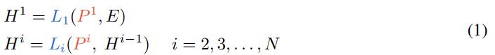

# All You Need is One: Capsule Prompt Tuning with a Single Vector

[all-you-need-is-one-capsule-prompt-tuning-with-a-single-vector-Paper-Conference_compressed.pdf](all-you-need-is-one-capsule-prompt-tuning-with-a-single-vector-Paper-Conference_compressed.pdf)

#### Abstract

This paper introduces a new method called `Capsule Prompt-Tuning (CaPT)` that helps Large Language Models (LLMs) perform different tasks more efficiently.

Existing prompt-tuning methods often require many prompts and experiments to find the best prompt length, which increases computational cost. They also mainly focus on the task rather than the specific input.

CaPT solves this problem by combining information about the task and the specific input into a single small prompt. It places important input-related information at the beginning to help the model focus on relevant details. This improves performance while requiring very few trainable parameters.

Main achievement: Better performance with fewer prompts, fewer trainable parameters, and lower computational overhead.

#### Important Keywords (Very Easy Definitions)

- LLM (Large Language Model): An AI model trained on large amounts of text to understand and generate language.
- Fine-Tuning: Further training an existing AI model for a specific task.
- PEFT (Parameter-Efficient Fine-Tuning): Adapting a model by training only a small number of parameters instead of the entire model.
- Prompt: Instructions or information given to an AI model.
- Prompt-Tuning: A method that learns small prompts to improve model performance without updating most model parameters.
- Task-Aware Information: Information about what the model needs to do, such as sentiment classification.
- Instance-Aware Information: Information about the specific input being processed, such as the meaning of a particular review.
- Grid Search: Testing multiple combinations of settings to find the best one.
- Attention Mechanism: A technique that helps an AI model focus on important parts of its input.
- Attention Anchor: Information placed at the beginning of the input that helps the model maintain attention on important details.
- Capsule Prompt-Tuning (CaPT): The proposed method that combines task-specific and input-specific information using a single compact prompt.

#### Simple Example

Task: Classify a movie review as positive or negative.

Input: "The movie was slow, but the ending was amazing."

- Traditional Prompt-Tuning: Uses a learned prompt mainly designed for sentiment classification.
- CaPT: Also includes information about this particular review, such as its mixed sentiment, to guide the model.

#### Key Research Contribution

CaPT improves prompt-tuning by using a single compact prompt containing both task-aware and instance-aware information, helping the model focus on important input details with extremely few trainable parameters.

#### 1 Introduction

Large Language Models (LLMs) are powerful AI models, but adapting them to specific tasks through traditional fine-tuning requires significant computational resources. To solve this, researchers use Parameter-Efficient Fine-Tuning (PEFT), which trains only a small number of parameters.

One popular PEFT method is Prompt-Tuning, where small, trainable prompts guide the model without changing its original parameters.

However, existing prompt-tuning methods have two major problems:

1. Limited Capability: Traditional soft prompts mainly learn general task information but do not interact effectively with the specific input text.
2. Inefficient Searching: Researchers must experiment with different prompt lengths to find the best one, which wastes time and computing resources.

To address these problems, the researchers introduce Capsule Prompt-Tuning (CaPT). It combines information about the task and the specific input into just one compact prompt. This prompt also acts as an attention anchor, helping the model focus on important input information.

Main Result: CaPT improves model performance while reducing the number of trainable parameters and training costs. The paper reports a 7.5% performance improvement over standard Prompt-Tuning on T5-Large.

#### Important Keywords — Simple Definitions

- Pre-trained Model: An AI model that has already learned from large amounts of data.
- Downstream Task: A specific task, such as sentiment analysis or text classification.
- Prompt-Based Learning: Guiding a model's behavior using prompts.
- Discrete Prompt: A prompt written using normal human-readable words.
- Soft Prompt: Trainable numerical representations added to a model's input rather than ordinary text instructions.
- Embedding: A numerical representation of text that a model can process.
- Token: A small unit of text or model input, such as a word, part of a word, or a special learned vector.
- Learnable Vector: A collection of numbers that the model adjusts during training.
- Training Overhead: Additional computing time, memory, or resources needed for training.
- State-of-the-Art (SOTA): Performance that matches or exceeds the strongest existing methods on a particular benchmark.

#### 2 Related Works

#### Attention in Large Language Models

Older AI models, such as RNNs and CNNs, have limitations in understanding complex relationships within text. Modern LLMs use Transformers, which help them understand context and relationships between words more effectively. Researchers have discovered that studying attention patterns can explain how models process information and make decisions. However, the role of attention in prompt-based learning has not been explored enough. This paper investigates how attention works in prompt-tuning and proposes a better prompt design to improve model performance.

#### New Keywords & Definitions

- RNN (Recurrent Neural Network): A neural network that processes sequential data, such as text, step by step.
- CNN (Convolutional Neural Network): A neural network that detects patterns in data, commonly used for images and sometimes text.
- Transformer: A neural network architecture that uses attention to understand relationships between different parts of input data.
- Attention Pattern: A representation of which tokens receive attention from other tokens.
- Model Interpretability: Understanding why and how an AI model makes decisions.
- Attention Sink: A phenomenon where certain tokens attract a large amount of attention, even when they are not particularly important to the task.
- Internal Representation: Information encoded inside a model as numerical values while processing input.
- Probing: Analyzing what information a model has learned internally.

#### Key Research Takeaway

Existing research studies attention in Transformers, but its role in prompt-based learning remains insufficiently explored. CaPT aims to improve prompt design by understanding how prompts interact with input tokens through attention.

#### Parameter-Efficient Fine-Tuning

PEFT helps adapt large AI models to specific tasks without training all their parameters, reducing computational costs. There are three main types of PEFT: Reparameterization, Adapter Tuning, and Prompt-Based Learning. The first two methods modify parts of the model and can require additional parameters and computational resources. Prompt-based learning is more flexible because it mainly adds trainable prompts to the input without changing the original model. However, traditional prompt-tuning has two problems: it focuses on general task information rather than specific input details, and it requires time-consuming experiments to find the best prompt length. To solve these problems, the researchers propose CaPT, which combines task-specific and input-specific information in a single compact prompt.

#### New Keywords & Definitions

- Reparameterization: A PEFT approach that trains a small set of parameters to represent updates to a model's existing weights.
- LoRA (Low-Rank Adaptation): A popular reparameterization method that uses small, trainable matrices to adapt a large model.
- Adapter Tuning: A PEFT method that inserts small, trainable neural network modules into an existing model.
- Low-Rank Matrix: A matrix whose information can be represented using smaller matrices, reducing the number of parameters needed.
- Model Architecture: The structure and organization of a neural network.
- Task Switching: Changing a model from performing one task to another.
- Structural Information: Important information about how input tokens are organized and related.
- Instance Semantics: The meaning and contextual information of a particular input.

#### Key Research Takeaway

CaPT aims to overcome traditional prompt-tuning limitations by combining task-aware and instance-aware information into a single prompt, improving contextual attention while reducing parameter usage and the need for prompt-length searching.

#### 3 Methodology

This section explains how Capsule Prompt-Tuning (CaPT) works, starting with an existing method called Deep Prompt-Tuning (P-Tuning v2). In Deep Prompt-Tuning, the original LLM remains frozen (its parameters are not updated), while small, trainable prompts are added to different Transformer layers. These prompts help the model learn new tasks without retraining the entire model. The researchers use this method as a baseline to explain how CaPT can improve performance while avoiding time-consuming searches for the best prompt length.

#### New Keywords & Definitions

- Methodology: The methods and steps researchers use to solve a problem.
- Deep Prompt-Tuning (P-Tuning v2): A method that adds trainable soft prompts to multiple Transformer layers while keeping the original model frozen.
- Baseline: An existing method used to compare and evaluate a new approach.
- Frozen Parameters: Model parameters that remain unchanged during training.
- Transformer Layer: One processing stage within a Transformer model.
- Contextual Embedding: A numerical representation of a token that incorporates information from its surrounding context.
- Embedding Layer: The part of a model that converts input tokens into numerical representations.

#### Understanding the Equation (Very Simply)

The paper uses:

- Pᵢ: Trainable prompts added to Transformer layer i.
- E: Numerical representations of the input text.
- Lᵢ: Transformer layer i.
- Hᵢ: Output produced by Transformer layer i.
- N: Total number of Transformer layers.

Simple idea: Each Transformer layer processes the information from the previous layer together with its own trainable prompts.

#### Key Research Takeaway

Deep Prompt-Tuning uses trainable prompts across multiple Transformer layers while keeping the main model frozen. CaPT builds on this research to develop a more efficient prompt-learning approach.

#### 3.1 Key Findings

#### Finding I: Task-aware prompts exhibit limited interplay with input sequences.

The researchers discovered that traditional soft prompts mainly focus on each other instead of interacting with the actual input text. Meanwhile, regular input tokens pay strong attention to important parts of the sentence, such as words that indicate its structure. This is a problem because soft prompts may miss important information needed to understand the input correctly. Therefore, the researchers investigate whether adding meaningful information about the specific input (instance-aware information) to prompts can improve attention and model performance.

#### New Keywords & Definitions

- Attention Head: A component of the attention mechanism that learns which tokens should focus on other tokens.
- Encoder Layer: A Transformer processing layer that helps build contextual representations of input.
- Syntactic Parsing: Analyzing the grammatical structure of a sentence.
- Semantic Parsing: Analyzing the meaning of a sentence.
- Hierarchical Relationship: How different parts of information are organized and connected at different levels.

#### Key Research Takeaway

Traditional soft prompts pay more attention to themselves than to important input tokens. CaPT investigates whether adding instance-aware information can create stronger connections between prompts and input text, improving model understanding.

#### Image

This figure compares traditional Deep Prompt-Tuning with a modified version that adds one instance-aware token. On the left, traditional soft prompts mostly pay attention to each other and interact weakly with important input tokens, achieving 78.34% accuracy. On the right, adding just one instance-aware token helps the model focus more strongly on important input information and allows input tokens to pay more attention to the added token. This improves accuracy to 79.33% without additional fine-tuning, showing that input-specific information can improve prompt-tuning.

Understanding the Figure

- Dark Red: Higher attention score (stronger attention).
- Dark Blue: Lower attention score (weaker attention).
- Rows (Query): Tokens that are paying attention.
- Columns (Key): Tokens receiving attention.
- ★ Green Star: The newly added instance-aware token.

#### New Keywords & Definitions

- Attention Score: A numerical value indicating how strongly one token attends to another.
- Attention Heatmap: A color-coded chart showing attention scores between tokens.
- RTE (Recognizing Textual Entailment): A task that checks whether one sentence logically follows from another.
- Validation Set: Data used to evaluate a model during development.

#### Key Research Takeaway

Adding just one meaningful instance-aware token improves attention interaction and increases accuracy from 78.34% to 79.33% (a gain of 0.99 percentage points), supporting CaPT's central idea that better prompt information can improve performance without adding many trainable prompts.

#### Finding II: Instance-aware tokens can enhance model performance without fine-tuning.

The researchers discovered that adding just one instance-aware token can improve model accuracy without additional fine-tuning. They tested this using T5-Base on two tasks (RTE and COPA). Surprisingly, one token produced better results, but adding more tokens (2, 3, 4, or 10) gradually reduced performance, sometimes making it worse than traditional Deep Prompt-Tuning. This shows that providing useful information is more important than providing more information. These findings support CaPT's design of using a single compact prompt.

#### New Keywords & Definitions

- Pooling: A technique that combines information from multiple tokens into a smaller representation.
- Prepending: Adding something at the beginning of a sequence.
- COPA (Choice of Plausible Alternatives): A task that tests whether a model can identify the most reasonable cause or effect of an event.
- Prompt Pruning: Removing unnecessary prompt tokens to improve efficiency or performance.
- Guidance Signal: Information that helps direct a model toward making better predictions.
- Model Capacity: A model's ability to learn and use information effectively.

#### Key Research Takeaway

A single instance-aware token improves model accuracy without additional fine-tuning, while adding more tokens can reduce performance. This suggests that prompt quality matters more than prompt length.

#### Image

This figure shows how adding different numbers of instance-aware tokens affects the accuracy of T5-Base on two tasks: RTE and COPA. Without instance-aware tokens, accuracy is 78.3% for RTE and 59.0% for COPA. Adding just one token increases accuracy to 79.3% and 63.0%, respectively, without additional fine-tuning. However, adding more tokens generally decreases performance. This demonstrates that one meaningful token can be more effective than multiple tokens.

#### Understanding the Figure

| Number of Tokens | RTE Accuracy | COPA Accuracy |
| --- | --- | --- |
| 0 (Original) | 78.3% | 59.0% |
| 1 (Best) | 79.3% | 63.0% |
| 2 | 78.7% | 58.0% |
| 3 | 78.3% | 57.0% |
| 4 | 78.3% | 54.0% |
| 10 | 74.3% | 55.0% |

#### Key Research Takeaway

Adding one instance-aware token improves accuracy on both tasks without additional fine-tuning, but adding more tokens generally reduces performance. This supports CaPT's use of a single compact prompt.

#### Finding III: Instance-aware tokens present strongly attentive interaction with input sequences as “attention anchor.”

The researchers discovered that instance-aware tokens create stronger attention connections with input text than traditional soft prompts. Unlike soft prompts, which mainly focus on themselves, an instance-aware token both receives attention from input tokens and pays attention to important input information. This two-way interaction helps the model use input-specific guidance more effectively. Researchers call this behavior an “attention anchor.” Based on this finding, they design CaPT to improve how prompts interact with input text.

#### New Keywords & Definitions

- Representation Learning: The process of learning useful numerical representations of data.
- Gradient Flow: How information about training errors moves backward through a neural network to update trainable parameters.
- Adaptive Prompt Design: Designing prompts that adjust their guidance based on the specific input.
- Robust Performance: Consistently good results across different conditions or settings.

#### Key Research Takeaway

Instance-aware tokens act as attention anchors by establishing strong two-way attention with important input tokens, motivating CaPT's design for more effective prompt-based learning.

#### Image

This figure compares traditional Deep Prompt-Tuning with the proposed CaPT method. Deep Prompt-Tuning adds multiple trainable soft prompts to different Transformer layers, requiring approximately 1 million trainable parameters. In contrast, CaPT uses just one capsule prompt per layer, combining task-aware information (what the model should do) with instance-aware information (details about the specific input). CaPT requires only approximately 9,000 trainable parameters in this illustration, while keeping the original Transformer layers frozen. This makes CaPT much more parameter-efficient and helps establish stronger attention connections with input text.

#### Understanding the Figure

- Left (a): Deep Prompt-Tuning uses multiple trainable prompts at each layer.
- Middle (b): CaPT uses one compact capsule prompt at each layer.
- Right: Shows how each capsule prompt combines learned task-aware guidance with instance-aware information obtained by averaging input representations.
- Yellow boxes with red borders: Trainable parameters.
- Gray boxes and blue snowflakes: Frozen parameters.
- Red capsule: The combined capsule prompt.

#### New Keywords & Definitions

- Capsule Prompt: A compact prompt combining task-aware and instance-aware information.
- Mean (Averaging): Combining several numerical representations by calculating their average.

#### Key Research Takeaway

CaPT replaces multiple trainable soft prompts with a single compact capsule prompt per layer, reducing trainable parameters from approximately 1 million to 9,000 while combining task-specific and input-specific information.

#### 3.2 Capsule Prompt-Tuning

The researchers propose Capsule Prompt-Tuning (CaPT), which uses only one trainable capsule vector per Transformer layer instead of multiple soft prompts. Each capsule combines task-aware information (what the model needs to do) with instance-aware information (the meaning of the specific input). The instance-aware information is obtained by averaging input representations at the first layer and previous-layer representations at later layers. This allows the capsule to adapt to each input while the original model remains frozen. As a result, CaPT reduces trainable parameters, eliminates prompt-length searching, and helps the model focus on important input information through attention anchors.

#### Understanding the Equations

First Transformer Layer:

`S¹ = p¹ + Mean(E)`

The first capsule prompt combines a trainable vector with the average numerical representation of the input text.

Later Transformer Layers:

`Sⁱ = pⁱ + Mean(Sⁱ⁻¹ ⊕ Hⁱ⁻¹)`

Each new capsule combines its trainable vector with the average of the previous layer's processed capsule and input representations.

Simple idea: Each layer creates a new capsule using what was learned about the task and what the previous layer understood about the input.

#### New Keywords & Definitions

- Instance-Adaptive: Automatically adjusting based on the specific input being processed.
- Concatenation (⊕): Joining multiple representations into one sequence.
- Hidden State: An internal numerical representation produced while a neural network processes information.
- Inductive Bias: Assumptions or preferences that help a model learn patterns from data.
- Contextual Grounding: Connecting the model's processing or predictions to relevant information from the actual input.
- Length-Invariant Prompt: A prompt whose length stays fixed regardless of input length.

#### Key Research Takeaway

CaPT creates one adaptive capsule prompt per Transformer layer by combining a trainable task-aware vector with averaged instance-aware representations, achieving efficient prompt-tuning without searching for the optimal prompt length.

#### 4 Experiments

We include a performance comparison with other PEFT methods in Appendix §S4, and analyze the differences between CaPT and other instance-incorporated prompt-based methods in Appendix §S3

#### 4.1 Experimental Setup

Code: [CaPT GitHub Repository](https://github.com/comeandcode/CaPT?utm_source=chatgpt.com)

The researchers tested CaPT on six language-understanding datasets from SuperGLUE using four pre-trained models: T5-Base (220M), T5-Large (770M), Llama-3.2 (1B), and Qwen-2.5 (1.5B). They compared CaPT with traditional fine-tuning and other prompt-tuning methods to evaluate its effectiveness. The models were trained for up to 50 epochs, using batch sizes of 16–32 and early stopping. Unlike traditional prompt-tuning, CaPT does not require searching for the best prompt length. The experiments were implemented using PyTorch and NVIDIA RTX 6000 Ada GPUs, and the researchers publicly released their code.

#### New Keywords & Definitions

- NLU (Natural Language Understanding): The ability of AI models to understand the meaning of human language.
- SuperGLUE: A collection of challenging language-understanding tasks used to evaluate AI models.
- BoolQ: A dataset containing questions that require yes-or-no answers.
- MRC (Machine Reading Comprehension): A task where a model answers questions based on a passage.
- Natural Language Inference (NLI): Determining whether one statement logically supports, contradicts, or is unrelated to another.
- CB (CommitmentBank): A dataset used to evaluate natural language inference.
- WiC (Word-in-Context): A task that checks whether a word has the same meaning in two different sentences.
- Epoch: One complete pass through the training dataset.
- Batch Size: The number of training examples processed together before a model update.
- Learning Rate: A setting that controls how much trainable parameters change during training.
- Early Stopping: Stopping training when validation performance stops improving.
- Hyperparameter: A training setting chosen before or during experimentation, such as learning rate or batch size.
- Classification Head: The final part of a model that converts learned representations into class predictions.
- PyTorch: A software framework used to build and train deep learning models.
- Reproducibility: The ability of other researchers to repeat an experiment and verify its results.

#### Key Research Takeaway

The researchers evaluate CaPT across multiple language tasks and model sizes to test whether it provides strong performance with fewer trainable parameters and without costly prompt-length searching.

#### 4.2 Main Results

The researchers found that CaPT performs better than many existing fine-tuning methods while using very few trainable parameters. On T5-Base, CaPT achieves 99.56% of full fine-tuning's average performance, while on T5-Large, it even slightly outperforms full fine-tuning by 0.43%. CaPT also improves performance on Llama-3.2-1B and Qwen-2.5-1.5B, although its gains are smaller than on T5 models. Most importantly, CaPT trains no more than 0.004% of the model's parameters and avoids time-consuming prompt-length searches, making it highly efficient.

#### Important Experimental Results

| Model | Main Result |
| --- | --- |
| T5-Base | Reaches 99.56% of full fine-tuning performance |
| T5-Large | Exceeds full fine-tuning performance by 0.43% |
| Llama-3.2-1B | Reports a 24.44% improvement over Linear Head adaptation |
| Qwen-2.5-1.5B | Reports a 10.56% improvement over P-Tuning v2 |

#### New Keywords & Definitions

- Encoder-Decoder Architecture: A model structure where an encoder processes the input and a decoder generates the output.
- Decoder-Only Architecture: A model structure that generates text by predicting tokens using previous tokens.
- Causal Language Model: A model trained to predict the next token based on preceding tokens.
- Pre-training Objective: The learning task used when initially training a model, such as predicting missing or next tokens.
- Parameter Efficiency: Achieving good performance while training relatively few model parameters.

#### Key Research Takeaway

CaPT achieves competitive or superior performance across different LLM architectures while training at most 0.004% of model parameters, demonstrating that effective instance-aware prompts can greatly reduce fine-tuning costs.

#### Image

### 1. Easy Summary

This table compares CaPT with traditional fine-tuning and other prompt-tuning methods across six language-understanding tasks and four AI models. CaPT achieves the highest average score among parameter-efficient methods on all four models. On T5-Large, it even slightly outperforms full fine-tuning (84.03 vs. 83.60). Most importantly, CaPT achieves these results while training only 0.003%–0.004% of model parameters, compared with 100% for full fine-tuning. This demonstrates that CaPT can achieve strong performance with extremely few trainable parameters.

### . Understanding the Table

| Model | CaPT Average Score | Full Fine-Tuning / Linear Head |
| --- | --- | --- |
| T5-Base | 77.51 | 77.85 |
| T5-Large | 84.03 | 83.60 |
| Llama-3.2-1B | 67.51 | 54.25 |
| Qwen-2.5-1.5B | 63.17 | 58.10 |

For Llama and Qwen, the comparison is against Linear Head adaptation, not full fine-tuning.

- # Para: Percentage of model parameters trained.
- Bold values: Best results among methods other than full fine-tuning.
- Underlined values: Second-best results.
- Average Score: Average performance across the six tasks, with results averaged over three experimental runs.

### 3. New Keywords & Definitions

- Accuracy (Acc): The percentage of predictions the model gets correct.
- F1 Score: A metric that balances precision and recall when evaluating predictions.
- Precision: The proportion of predicted positive cases that are actually positive.
- Recall: The proportion of actual positive cases correctly identified by the model.
- Experimental Run: One complete execution of an experiment.

### 4. Key Research Takeaway

CaPT achieves the best average performance among the evaluated parameter-efficient methods across all four models while training only a tiny fraction of their parameters, demonstrating that carefully designed prompts can compete with much more expensive fine-tuning approaches.

#### 4.3 Attention Anchor

The researchers compared CaPT with traditional Deep Prompt-Tuning, using one prompt per Transformer layer. They discovered that CaPT creates stronger two-way attention between its capsule prompt and the input text. First, the capsule prompt focuses on important structural tokens, helping the model understand the input better. Second, input tokens strongly attend to the capsule prompt, allowing it to guide the entire input sequence. Traditional soft prompts show much weaker interactions. This confirms the attention anchor behavior of CaPT, which is associated with improved performance, including a reported 6.73% improvement on the CB task.

#### New Keywords & Definitions

- Mutual Attention: Two-way attention where two tokens attend to each other.
- Context-Sensitive Attention: Attention that changes depending on the specific input and its meaning.
- Global Guidance: Information that helps guide processing across the entire input sequence.

#### Key Research Takeaway

CaPT creates an effective attention anchor by focusing on important input tokens while also receiving strong attention from them, helping explain its performance improvements over traditional prompt-tuning.

#### Image

This figure compares CaPT and traditional Deep Prompt-Tuning on two tasks: RTE and CB. The attention heatmaps show that CaPT focuses more strongly on important input tokens and receives greater attention from other tokens, creating effective two-way attention. Traditional Deep Prompt-Tuning shows weaker interaction with important input information. As a result, CaPT achieves 79.78% accuracy on RTE compared to 76.90%, and 94.16 on CB compared to 87.31. These results support the researchers' claim that CaPT's attention anchor helps improve model performance.

### . Understanding the Figure

| Task | CaPT | Deep Prompt-Tuning |
| --- | --- | --- |
| RTE (Accuracy) | 79.78% | 76.90% |
| CB (Score) | 94.16 | 87.31 |
- Blue boxes: Important input tokens that receive strong attention from CaPT's capsule prompt.
- Yellow boxes: Strong attention received by the capsule prompt from input tokens.
- Black boxes: Weaker attention toward important tokens in traditional Deep Prompt-Tuning.
- Dark Red: Stronger attention; Dark Blue: Weaker attention.

### 3. New Keywords & Definitions

No new technical keywords are introduced in this figure.

### 4. Key Research Takeaway

CaPT establishes stronger two-way attention between its capsule prompt and important input tokens, supporting the attention anchor idea and achieving better performance than traditional Deep Prompt-Tuning.

#### 4.4 Training Time Comparison

The researchers compared the total training time of CaPT with other prompt-tuning methods across six SuperGLUE tasks. They found that CaPT is significantly more time-efficient because it does not require experimenting with different prompt lengths. Traditional methods like Prompt-Tuning and P-Tuning v2 can require 8.77× as much training time, while more complex methods like M-IDPG and LoPA can require 14.93× as much time due to additional parameter searches. This demonstrates that CaPT can reduce overall training time while maintaining strong model performance.

#### New Keywords & Definitions

- Training Time: The total time required to train a model; in this comparison, it also includes time spent searching for suitable settings.
- Rank: A setting that controls the size or complexity of certain low-rank representations used in parameter-efficient methods.
- M-IDPG: A competing instance-dependent prompt-generation method evaluated by the researchers.
- LoPA: A competing parameter-efficient prompt adaptation method evaluated by the researchers.

#### Key Research Takeaway

CaPT significantly reduces total training time by eliminating prompt-length grid search, making it more computationally efficient than traditional prompt-tuning methods without sacrificing strong performance.

#### Image

This table compares CaPT with four other prompt-tuning methods in terms of training time, trainable parameters, and model performance. CaPT is the fastest method, using only 0.004% of model parameters and achieving an average score of 77.51. Other methods require approximately 8–15 times more total training time. Although LoPA achieves a slightly higher score (77.98), it takes 14.93 times longer than CaPT. This shows that CaPT offers an excellent balance between performance, training speed, and parameter efficiency.

#### Understanding the Table

| Method | Training Time | Average Score |
| --- | --- | --- |
| Prompt-Tuning | 8.77× | 72.13 |
| P-Tuning v2 | 8.37× | 76.94 |
| M-IDPG | 12.58× | 76.96 |
| LoPA | 14.93× | 77.98 |
| CaPT (Ours) | 1.00× | 77.51 |

Training times are relative to CaPT (1.00×), including hyperparameter searching.

#### New Keywords & Definitions

- Relative Training Time: Training duration expressed as a multiple of another method's training time.
- Efficiency–Performance Trade-off: The balance between computational resources used and model performance achieved.

#### Key Research Takeaway

CaPT achieves nearly the highest average score while requiring substantially less training time and fewer trainable parameters, making it a highly efficient alternative to existing prompt-tuning methods.

#### 4.5 Ablation Study

We include a performance comparison with other PEFT methods in Appendix §S4, and analyze the differences between CaPT and other instance-incorporated prompt-based methods in Appendix §S3

#### CaPT Variants.

The researchers tested four different ways to combine task-aware and instance-aware information in CaPT: Addition, Prepending, Extraction, and Projection. All four methods achieved similar performance on T5-Base. Projection achieved the highest score (77.64%), but required 17.5 times more trainable parameters than Addition. Addition achieved a nearly identical score (77.51%) while using only 0.004% of model parameters. Therefore, the researchers selected Addition as the default CaPT method because it is simpler and more parameter-efficient.

#### Understanding Table 3

| CaPT Variant | Trainable Parameters | Average Score |
| --- | --- | --- |
| Addition (Default) | 0.004% | 77.51% |
| Prepending | 0.004% | 77.44% |
| Extraction | 0.03% | 77.21% |
| Projection | 0.07% | 77.64% |

#### New Keywords & Definitions

- Addition: Combining task-aware and instance-aware vectors by adding their numerical values.
- Extraction: Using trainable filters to identify useful information from input representations.
- Projection: Using trainable mathematical transformations to convert input information into a useful representation.
- 1D Convolutional Filter: A small trainable operation that detects patterns across a sequence.
- Low-Rank Linear Layer: A neural network layer that uses smaller matrices to reduce the number of trainable parameters.

#### Key Research Takeaway

CaPT's simple Addition method achieves almost the same performance as the more complex Projection method while using 17.5 times fewer trainable parameters, making Addition the preferred design.

#### Image

This figure illustrates three alternative designs of CaPT: Prepending, Extraction, and Projection. All three combine task-aware and instance-aware information but use different techniques. Prepending places the instance-aware representation and trainable task prompt next to each other as separate tokens. Extraction uses a trainable 1D convolution to identify useful input features before combining them with the task prompt. Projection uses trainable low-rank layers to transform input information before combining it with the task prompt. Although these methods work well, the researchers prefer the original Addition method because it achieves similar performance with fewer trainable parameters.

### . Understanding the Figure

- Prepending: Keeps task-aware and instance-aware information as two separate tokens.
- Extraction: Uses a trainable filter to extract useful input information, then adds it to the task-aware vector.
- Projection: Transforms input information using trainable layers, then adds it to the task-aware vector.
- Addition (Default, not shown): Directly adds the trainable task-aware vector to the average input representation.

### 3. New Keywords & Definitions

- FFN (Feed-Forward Network): A neural network component that transforms information through one or more layers.
- Up/Down Projection: Transforming numerical representations into larger or smaller dimensions.

### 4. Key Research Takeaway

All CaPT variants combine task-aware and instance-aware information, but the simple Addition method provides the best balance between model performance and parameter efficiency.

#### CaPT Length.

The researchers investigated whether increasing the number of capsule prompts improves model performance. They tested different prompt lengths (1, 2, 3, 4, 5, 10, and 20) on T5-Base and Llama3.2-1B. The results show that a single capsule prompt achieves the best performance on both models. Using two prompts produces almost identical results, but adding more prompts generally reduces accuracy. For example, Llama3.2-1B's average score drops from 67.51 to 59.38 when prompt length increases from 1 to 20. This confirms that prompt quality matters more than prompt quantity.

### . Understanding Figure 6 (Top)

| Prompt Length | T5-Base Score | Llama3.2-1B Score |
| --- | --- | --- |
| 1 (Best) | 77.51 | 67.51 |
| 2 | 77.44 | 67.49 |
| 3 | 73.81 | 67.04 |
| 4 | 73.85 | 65.52 |
| 5 | 70.13 | 65.97 |
| 10 | 70.40 | 62.13 |
| 20 | 70.35 | 59.38 |

#### New Keywords & Definitions

- Prompt Length: The number of prompt tokens used to guide the model.
- Prompt Depth: The number of Transformer layers where prompts are introduced.

#### Key Research Takeaway

A single capsule prompt provides the strongest results, while increasing prompt length generally reduces performance. This supports CaPT's design of using one compact, informative prompt instead of multiple prompts.

#### CaPT Depth.

The researchers investigated which Transformer layers should use CaPT to achieve the best performance. They tested five configurations on T5-Base and Llama3.2-1B. The results show that applying CaPT to all Transformer layers produces the highest performance on both models. Interestingly, applying CaPT to every odd-numbered layer performs better than applying it only to the first or last half of the layers. This suggests that distributing capsule prompts throughout the model is more effective than concentrating them in one section.

### . Understanding Figure 6 (Bottom)

| Configuration | T5-Base | Llama3.2-1B |
| --- | --- | --- |
| (a) Input layer only | 70.55 | 59.69 |
| (b) First half of layers | 73.31 | 63.75 |
| (c) Last half of layers | 73.67 | 65.08 |
| (d) Every odd-numbered layer | 75.28 | 65.52 |
| (e) All layers | 77.51 | 67.51 |

### 3. New Keywords & Definitions

- Layer Configuration: The selection of Transformer layers where a method is applied.
- Sparse Distribution: Applying a method to selected, separated layers instead of every layer or one continuous group.

### 4. Key Research Takeaway

CaPT achieves the best performance when applied to all Transformer layers, while distributing prompts across separated layers is more effective than concentrating them in only one part of the model.

#### 5 Conclusion

Traditional prompt-tuning methods have two major problems: weak interaction with input text and time-consuming searches for the best prompt length. To solve these problems, the researchers introduce Capsule Prompt-Tuning (CaPT), which combines task-aware and instance-aware information into a single compact prompt per Transformer layer. This prompt acts as an attention anchor, helping the model focus on important input information. Experimental results show that CaPT achieves strong performance while using very few trainable parameters and reducing overall training time. The researchers believe this approach opens new opportunities for developing more efficient LLM adaptation methods.

#### Key Research Takeaway

CaPT demonstrates that combining task-aware and instance-aware information into a single compact prompt can improve LLM performance, strengthen attention interactions, and significantly reduce fine-tuning costs.

#### Keywords

- Prompt-based learning
- downstream task
- grid searching
- prompt tuned model
- prompt-tuning
- prompt-tuning method
- downstream task
- learnable soft prompts
- prompting methods
- discrete method
- trainable soft prompts
- soft prompt-based learning
- diverse instances
- learnable vectors
- capsuled prompts
- vanilla prompt-tuning
- Transformer
- input sequence
- probing
- deep prompt-tuning
-